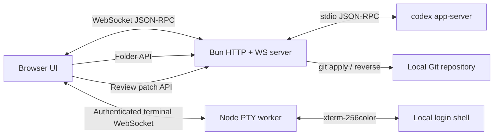

# Codex WebUI

<p align="center">
  <strong>A local, LAN-accessible WebUI for the real Codex app-server.</strong>
</p>

<p align="center">
  <a href="./README-zh.md">简体中文</a> ·
  <a href="./CONTRIBUTING.md">Contributing</a> ·
  <a href="./SECURITY.md">Security</a>
</p>

<p align="center">
  <a href="./LICENSE"></a>
  <a href="https://github.com/lezi-fun/codex-webui/stargazers"></a>
  <a href="https://github.com/lezi-fun/codex-webui/issues"></a>
  <a href="https://bun.sh/"></a>
</p>

> [!IMPORTANT]
> This is an **unofficial community project**. It is not affiliated with, endorsed by, or maintained by OpenAI. OpenAI and Codex are trademarks of their respective owners.

Codex WebUI connects directly to `codex app-server --stdio` and exposes the local Codex experience through a responsive browser interface. It keeps real threads, models, streaming responses, tool activity, approval requests, diffs, and token usage instead of simulating them in a static frontend.


## Highlights

- Real `codex app-server --stdio` bridge over WebSocket
- Real model catalog, reasoning effort options, threads, and streaming turns
- Two independently streaming chats in resizable, movable side-by-side panels
- Command, file-change, network, and permission approval surfaces
- Approval scopes such as **Allow once**, **Allow similar commands**, and session-level approval
- Tool activity states driven by real item/turn notifications
- Unified and split diff review, word wrap, expand/collapse, Undo, and Reapply
- Safe Markdown, GFM, fenced code blocks, links, and KaTeX rendering
- Project-folder picker with restricted filesystem browsing
- Codex-style sidebar account identity with display name, same-origin avatar fallback, and plan
- Codex Desktop-style 46px header with separate Bottom Panel, Summary, and Task Side Panel controls; the Bottom Panel opens its native-style New tab launcher
- Real Bottom Panel PTY terminal powered by xterm.js, with 256-color ANSI output, terminal resize, and interactive Vim/control-key support
- Collapsed-by-default Summary panel matching the native Environment, Scheduled, Computer Use, Plan, Side tasks, and Sources sections; app-server data is shown when available and native-store-only sections use explicit unavailable or empty states instead of fabricated content
- Collapsed-by-default Task Side Panel mirroring the native New tab launcher: Review opens the real diff, Files links to the restricted project picker, and its native-bridge-only Terminal, Browser, and Side task entries show an explicit availability notice instead of a simulated tool
- Light and dark surfaces driven by shared Codex-style color tokens, including the monochrome transparent Codex Knot
- Windowed long conversations instead of rendering thousands of turns at once
- Responsive desktop and mobile layouts with full-screen Summary and Task Side Panel drawers on phones
- Localhost-only by default; authenticated LAN access is opt-in

## Requirements

- [Bun](https://bun.sh/) 1.3 or newer
- Node.js 20 or newer, used by the native PTY worker
- [OpenAI Codex CLI](https://www.npmjs.com/package/@openai/codex), installed and authenticated
- Git, for Review Undo/Reapply
- macOS or Linux recommended; Windows has not been fully tested

Install Codex CLI if needed:

```bash
npm install -g @openai/codex
codex
```

Complete the Codex sign-in flow before starting this project.

## Two chat panels

Use the split button in the top bar to open a new chat alongside the current one, or use the split button on a chat in the sidebar to open that chat in the second panel. Drag a chat from the sidebar or a panel title to the left, right, top, or bottom to position it. Drag the divider, or focus it and use the arrow keys, to resize the panels. Clicking a chat in the sidebar opens it in the last focused panel; the close button closes the second panel without stopping its turn. Drafts are kept per chat and project for the current browser session.

On narrow screens the two panels are stacked vertically. Use the swap button in the top bar to exchange their positions; the divider uses the up and down arrow keys.

Both panels currently use the same account and environment. Each chat retains its own project and model selection; simultaneous execution with different accounts or environments is not yet supported.

## Quick start

```bash
git clone https://github.com/lezi-fun/codex-webui.git
cd codex-webui
bun install
bun run start
```

Open:

```text
http://127.0.0.1:8899
```

The default bind address is localhost. Use the folder button in the composer or sidebar to select the project Codex should work in.

### LAN password login

To listen on your LAN, start the server without an authentication variable:

```bash
HOST=0.0.0.0 bun run start
```

The first LAN browser sees a password setup screen. After a password of at least 12 characters is confirmed, Codex WebUI stores only a salted `scrypt` credential in `~/.codex/codex-webui-auth.json`, signs in that browser, and requires the password after a restart. Because the first reachable LAN client can claim this setup, complete it only on a trusted network.

For unattended deployments, provide the password at startup instead:

```bash
HOST=0.0.0.0 CODEX_WEBUI_PASSWORD='use-a-long-random-password' bun run start
```

Direct `localhost` access remains available without the password screen. LAN requests must set or enter a password before the main application bundle, HTTP APIs, or WebSocket bridges are available. Successful authentication uses a signed `HttpOnly`, `SameSite=Strict` session cookie.

Password login attempts are counted globally, including successful attempts, regardless of client or IP address. Delays are 2, 4, 8, 16, 32 and 64 seconds; further attempts receive HTTP 400. Only one login can be pending at a time. Restart or redeploy the server container to reset the counter. Basic/Bearer authentication does not use this limit.

`CODEX_WEBUI_ACCESS_TOKEN` remains available for compatibility with Basic/Bearer clients. `CODEX_WEBUI_PASSWORD` takes precedence over both the managed password and access token for browser login. Set `CODEX_WEBUI_AUTH_STORE` to move the managed credential file.

## Configuration

Copy the example file if you want custom settings:

```bash
cp .env.example .env
```

Bun does not automatically load every `.env` convention in all execution contexts, so exporting variables explicitly is the most predictable option:

```bash
export HOST=0.0.0.0
export PORT=8899
export CODEX_WEBUI_ACCESS_TOKEN="$(openssl rand -hex 32)"
export CODEX_WEBUI_CWD="$HOME/projects/my-project"
export CODEX_WEBUI_REVIEW_ROOT="$HOME/projects/my-project"
bun run start
```

| Variable | Default | Description |
| --- | --- | --- |
| `HOST` | `127.0.0.1` | HTTP/WebSocket bind address |
| `PORT` | `8899` | HTTP/WebSocket port |
| `CODEX_WEBUI_PASSWORD` | unset | Optional browser login password for LAN access; bypasses first-run setup |
| `CODEX_WEBUI_AUTH_STORE` | `$CODEX_HOME/codex-webui-auth.json` | Salted managed password credential created by first-run setup |
| `CODEX_WEBUI_ACCESS_TOKEN` | unset | Compatibility secret for Basic/Bearer clients and browser login when no password is configured; username `codex` |
| `CODEX_WEBUI_CWD` | repository directory | Initial Codex working directory |
| `CODEX_WEBUI_REVIEW_ROOT` | `CODEX_WEBUI_CWD` | Exact Git root allowed for Undo/Reapply |
| `CODEX_HOME` | `~/.codex` | Codex state directory containing `auth.json` |
| `CODEX_AUTH_PATH` | `$CODEX_HOME/auth.json` | Optional explicit Codex authentication file path |
| `PLAYWRIGHT_EXECUTABLE_PATH` | auto-detected | Optional Chrome/Edge path for browser tests |

## Security model

Codex WebUI can approve command execution and file changes on your machine. Treat it like a local developer tool with shell access.

- Do **not** expose port `8899` directly to the public Internet.
- The default listener is `127.0.0.1`. A non-localhost listener requires first-run password setup, `CODEX_WEBUI_PASSWORD`, or `CODEX_WEBUI_ACCESS_TOKEN` before protected HTTP and WebSocket requests are accepted.
- Browser RPC uses an explicit allowlist and cannot invoke app-server `fs/*`, `config/*`, or account methods.
- Static serving uses an asset allowlist and rejects symbolic links.
- Filesystem browsing canonicalizes paths and rejects symlinks that escape the user's home directory.
- Review Undo/Reapply uses server-owned app-server diffs, rejects client-supplied `cwd`/diff data, symbolic-link patches, and sensitive targets such as `.git`, `.env`, and `node_modules`.
- Read approval prompts before allowing commands.
- Account identity combines app-server `account/read` data with Codex's authenticated profile endpoint. It is available only through direct localhost access; LAN clients receive the neutral Settings fallback. Email and raw avatar URLs are not exposed, avatars use a same-origin allowlisted proxy, and `auth.json` tokens remain server-only.
- Never paste credentials into issues, screenshots, or public logs.

See [SECURITY.md](./SECURITY.md) for the reporting policy.

## Review and approvals

The WebUI handles app-server requests instead of drawing fake approval cards:

- `item/commandExecution/requestApproval`
- `item/fileChange/requestApproval`
- `item/permissions/requestApproval`

Review data is driven by `turn/diff/updated`. Unified diffs are parsed into files and hunks, and the Review panel supports:

- Unified / Split view
- Word wrapping
- Expand / Collapse all
- Git-backed Undo (`git apply --reverse`)
- Git-backed Reapply (`git apply`)

Undo/Reapply is deliberately restricted to the configured repository root.

The shell mirrors Codex Desktop's separate Bottom Panel, Summary, and Task Side Panel controls. The Bottom Panel provides a real authenticated local PTY terminal, while the app-server bridge provides the Review flow and restricted local project selection. Native Desktop-only Task Side Panel Terminal, embedded Browser, and Side task tabs remain visible for structural parity but show a clear unavailable message instead of simulating those capabilities.

## Architecture



Main files:

| Path | Responsibility |
| --- | --- |
| `server.ts` | HTTP server, WebSocket bridge, app-server process, folder/config/review APIs |
| `public/app.js` | Browser state, RPC, threads, approvals, activity, Review, project selection |
| `public/codex-surfaces.js` | Approval models, unified-diff parsing, split alignment, activity summaries |
| `public/rendering.js` | Sanitized Markdown and KaTeX rendering |
| `folder-service.js` | Restricted directory browsing |
| `review-service.js` | Validated Git Undo/Reapply operations |
| `tests/` | Unit, integration, browser, mobile, and real approval tests |

`public/app.bundle.js` is generated automatically when the server starts and is not committed.

During development, `bun run dev` watches both `server.ts` and the browser entry graph rooted at `public/app.js`. Backend changes restart the server, while frontend changes rebuild `public/app.bundle.js`; reload the page to use the new bundle.

Build the browser bundle and a runnable `dist/server.js`:

```bash
bun run build
bun dist/server.js
```

## Docker

The repository includes a Compose setup for a local container deployment. Set `CODEX_BIN` to an executable Codex CLI path before starting it; the path is mounted read-only into the container. The app starts in projectless mode by default and stores Codex state through the configured volume.

```bash
export CODEX_BIN="$HOME/.codex/packages/standalone/releases/VERSION/bin/codex"
export CODEX_WEBUI_REVIEW_ROOT="$HOME/projects/my-project"
docker compose up -d --build
```

The Compose example does not mount the host Docker socket. The image runs as the configured `PUID`/`PGID` user and receives runtime configuration through environment variables.

## Testing

Install Playwright's Chromium if you do not already have a compatible Chrome/Edge binary:

```bash
bunx playwright install chromium
```

Run the portable unit suite:

```bash
bun run test:unit
```

Check both Bun and browser bundles:

```bash
bun run check
```

With a running server:

```bash
bun run test:browser
```

Tests that require a working, authenticated Codex installation:

```bash
bun run test:integration
bun run test:e2e
```

The real approval E2E asks Codex to execute a harmless command, waits for the actual approval request, clicks **Allow once**, verifies the result, and cleans up its temporary file.

## Visual assets

The ZilpioWebUi logo is not covered by the MIT license. All rights to the logo are reserved by its owner. Use of the logo is permitted only to refer to ZilpioWebUi or its owner; other uses require prior permission. Do not imply endorsement.

## Known limitations

- The Codex app-server protocol is evolving and may change between CLI versions.
- Browser tests need a compatible Chromium browser.
- Undo/Reapply currently operates on the complete aggregated diff, not one hunk at a time.
- Authentication and public-Internet deployment are intentionally out of scope.

## Contributing

Please read [CONTRIBUTING.md](./CONTRIBUTING.md) before submitting a pull request. Bug reports and feature requests can be opened through the repository's Issue templates.

## License

Source code is available under the [MIT License](./LICENSE). Dependencies are covered by their own licenses. The ZilpioWebUi logo is excluded from the MIT license as described above.

### Managed accounts and project folders

Set `CODEX_WEBUI_MANAGED_ACCOUNTS=true` to enable **Account** below
chat. Add ChatGPT accounts using device authorization, then choose an account next
to the model in the chat composer. You can change the account of an existing idle
chat and continue its history. The change is shared across browser tabs and persists
after a restart. Different accounts have independent Codex processes, so their
chats can run concurrently in different panels or browser tabs. A switch waits for
the affected processes to be idle, including pending approvals.

Deleting a transferred chat removes its history from each account runtime. If deletion
is interrupted, the chat remains hidden while the server retries the cleanup.

Managed deployments have one environment, **Zilpio**. Every project uses the same
chat history for its account. Selecting a project only changes the working folder;
it does not restart Codex or interrupt active chats. In-flight requests use a runtime
revision to reject requests from a previous server process.

The deployment uses these persistent directories under `/home/codex`:

| Directory | Content |
| --- | --- |
| `.codex` | Existing default auth/history/config, retained |
| `.codex-logins` | Auth JSON files only, one per saved account |
| `.zilpio` | Zilpio chat history/database; links to default config and selected auth |
| `.webui` | Saved accounts, project metadata, per-account Zilpio histories, and migration backups |
| `el`, `zilpio` | Mounted project storage roots, independent of environment |

The existing default account is copied once to the auth vault. Existing `.codex`
conversations are retained there and are not automatically imported into Zilpio. Configuration assets are linked from the default home. Credentials created
by device login are saved only after successful authorization; failed/cancelled login
does not change the active account. Reauthorizing the active account requires an idle
runtime so its credentials can be replaced safely.

Quota bars show actual remaining percentages for 300-minute and 10080-minute windows
and the reset date/time in the browser's timezone. Missing/unsupported account quota
values display **Non disponibile**. These are usage allowances, not exact token counts.

Only WebUI-authenticated clients can access account management or quota endpoints.
Keep all persistent account directories private and back them up as credentials.

**Progetto** opens the folder browser: choose either mounted project root or a
subfolder. Existing project paths (including `/home/codex/el`) remain valid in Zilpio.
The environment selector and the command to move projects between environments
are hidden because there is only one environment. Saved account labels, including
accounts named EL, are independent of the removed El environment.

On the first managed startup after this upgrade, the server migrates `.El` and
any `.webui/runtime-homes/<account>/El` histories into their Zilpio counterparts.
It merges conversations, archived sessions, SQLite indexes, saved titles, project
appearance/visibility, chat ownership, pending handoffs/deletions and AutoReload
settings. A project visible in either previous list stays visible in Zilpio.
The migration runs before any Codex process starts. It stages and checks the data,
keeps consistent SQLite backups (including WAL commits) and original rollout files
under `.webui/migrations/el-to-zilpio-v1/<attempt>/backup`, and stops on conflicting
histories instead of overwriting them. A completion marker prevents deleted chats
from being imported again on subsequent restarts. After completion, El's old live
history files and project list are removed; their backups remain private.

Keep the legacy `.El` volume mounted for the first upgrade so the migration can
read it. After `.webui/migrations/el-to-zilpio-v1/complete.json` exists, that legacy
mount can be removed. The `el` **project** volume remains mounted because existing
working folders and repositories still use those paths.

Use **Progetto → Aggiungi progetto** to create a named subfolder in the currently
viewed folder. A successful creation selects that folder for the next new chat;
account and environment remain unchanged. Existing folders are never overwritten.

Project rows have a **⋯** menu for saved color and icon choices.
**Rimuovi dall'elenco** hides only the project entry: files and conversations remain
untouched, and its chats appear under **Altre chat**. Restore a hidden project through
**Progetto → Gestisci progetti → Ripristina**, or explicitly select its folder again.
Appearance and visibility metadata live in the existing persistent `.webui/projects.json`
and are shared across accounts, environments, and connected browsers.

### Shared Git SSH and Telegram settings

The settings gear in the upper-left sidebar opens the Git and Telegram configuration pages. These settings are shared across accounts, environments and projects, and are stored in the persistent `.webui` state directory. Configure Git with an unencrypted private key dedicated to this installation; register the displayed public key with your Git provider. Git uses that identity from the WebUI's Codex and terminal processes. The first SSH connection trusts and records the host key; subsequent changes are rejected. Use the connection test to inspect the provider's response.

The Git page also shows GitHub CLI accounts and their authorization status. From the same page you can authorize another account using a GitHub device code, choose the active account, edit a local nickname, or remove an account from the WebUI. Removing an account deletes its local CLI authentication; GitHub's authorized-applications page is available for revoking access on GitHub. This feature requires a GitHub CLI version that supports `gh auth status --json hosts`. Its credentials and Git configuration need persistent storage if the WebUI runs in a container.

For Telegram, enter the bot token and numerical user/chat ID, start a conversation with the bot, enable notifications, save and send a test message. The server sends a message on Codex turn completion, including failed or interrupted turns. Private keys and bot tokens are stored with restricted filesystem permissions and are not returned by the settings API. All WebUI users with access to settings share these credentials. Restart the WebUI service after installing an update so its server and child processes use the updated configuration.

When Telegram notifications are enabled, each successful password login or first-time password setup also sends `NUOVO LOGIN SU CODEX ZILPIOWEB RILEVATO!`. Automatic localhost access and Basic/Bearer requests do not create browser login sessions and do not send this notification.

### AutoReload after a usage limit

Each chat in the sidebar has an **AutoReload** switch. When Codex stops that chat because its usage limit has been reached, the red indicator stays visible until the reported reset time plus one minute and Codex confirms that usage is available again. If the weekly allowance is exhausted too, AutoReload waits for that reset. When enabled, the server sends `riparti` to that chat and sends a Telegram notification if Telegram notifications are configured and enabled. It keeps the schedule across browser closures and service restarts; the server must be running to send it. In managed mode, a pending restart waits until its original account and environment are active. If Codex cannot report a reset time or confirm available usage, the server waits and checks again instead of guessing.
